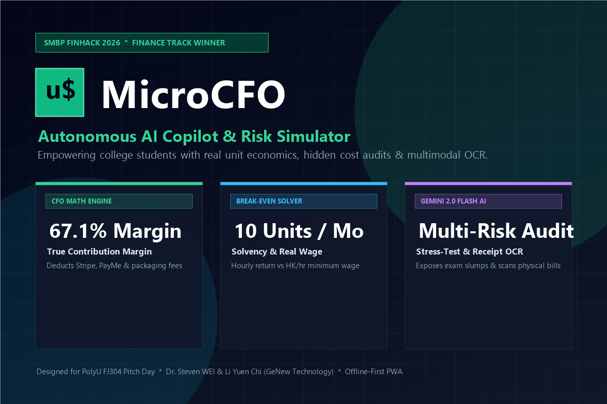
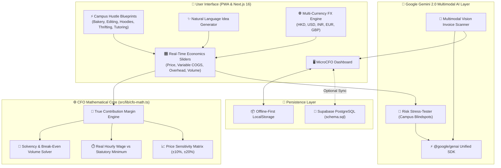
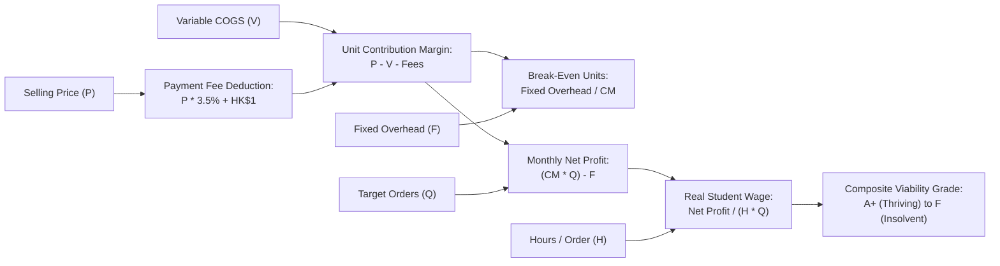

<div align="center">

# 🚀 MicroCFO (微型財務長)
### Autonomous AI Copilot & Risk Simulator for Student Side-Hustles

**Built for SMBP FinHack 2026 (小錢大計) • Finance Track (理財賽道)**  
*Organized by Hong Kong Polytechnic University (PolyU FJ304) & GeNew Technology Limited*

[](https://nextjs.org/)
[](https://react.dev/)
[](https://tailwindcss.com/)
[](https://aistudio.google.com/)
[](https://web.dev/progressive-web-apps/)
[](https://www.typescriptlang.org/)
[](https://opensource.org/licenses/MIT)

<br/>



<br/>

<p align="center">
  <strong>Stop losing money on university side-gigs.</strong><br/>
  MicroCFO brings corporate financial discipline to student ventures with true contribution margins, break-even solvers, student real hourly wage checks, Gemini AI risk stress-testing, and multimodal receipt OCR.
</p>

[✨ Live Working Demo](#-live-demo--deployment) • [📊 System Architecture](#-system-architecture--flowcharts) • [🧮 Core Financial Math](#-core-cfo-math-engine) • [🚀 Quick Start](#-quick-start) • [🏆 SMBP Hackathon Submission](#-hackathon-submission-package)

</div>

---

## 📌 The Problem
Over **80% of university student side-hustles** (campus bakeries, freelance video editing, custom society merchandise, Carousell vintage resale) shut down within 60 days.

* **The Illusion:** A student bakes cookies, spending HK$14 on flour/butter and selling for HK$45, believing they make **HK$31 profit (68% margin)**.
* **The Reality:** 
  1. **Hidden Take-Rates:** Payment gateways (PayMe, FPS, Stripe) take 3.5% + fixed fees per transaction.
  2. **Uncompensated Labor:** The student spends 40 hours a month to make HK$200 net profit—an effective hourly wage of **HK$5.00/hr**, far below campus minimum tutoring wages (HK$60/hr).
  3. **Exam Slumps & Perishability:** During midterm and finals weeks, campus demand plummets by 50%, while recurring tool subscriptions stay fixed, plunging the micro-business into insolvency.

Students lack access to fractional CFOs or accountants. **MicroCFO solves this completely.**

---

## 🏗️ System Architecture & Flowcharts

### 1. High-Level Architectural Flow


### 2. Financial Calculation Pipeline


---

## ⚡ Key Features

| Feature | Description | Tech Implementation |
| :--- | :--- | :--- |
| **🧮 Corporate Unit Economics** | Exposes true contribution margin after subtracting ingredient COGS, packaging, and payment gateway take-rates. | Pure TypeScript mathematical engine with 11 unit tests |
| **🎯 Break-Even & Solvency Solver** | Dynamically calculates minimum units required to cover fixed overhead, warning if unit margin is negative. | Closed-form formula with real-time interactive visual progress bar |
| **⏱️ Opportunity Cost Reality Check** | Compares student net profit per hour worked against statutory campus minimum wage benchmarks (HK$60/hr, $15/hr, ₹200/hr). | Labor division equation with risk flags |
| **✨ AI Idea-to-Blueprint Generator** | Type any raw idea in natural language; Gemini AI outputs realistic campus pricing, COGS, overhead, and volume. | Google GenAI SDK (`gemini-2.0-flash`) with structured JSON schema |
| **🚨 Gemini Risk Auditor** | Acts as an aggressive fractional CFO, stress-testing against exam-season demand drops and supplier price inflation. | Autonomous risk diagnostics with mitigation directives |
| **🧾 Multimodal Receipt OCR** | Upload physical store receipts; Gemini Vision extracts line items and automatically categorizes them into Fixed vs Variable costs. | Multimodal image inline payload processing |
| **📒 Operating Cash-Flow Ledger** | Offline-first transaction ledger tracking physical cash inflows, variable expenses, and fixed subscriptions. | Hybrid localStorage + Supabase PostgreSQL with RLS |
| **📄 1-Click Pitch Deck Summary** | Generates an executive 1-page financial feasibility report with a printable PDF layout (`window.print()`) and copyable Markdown. | Responsive print CSS stylesheet |
| **🌐 Dynamic FX Parity Engine** | Live currency conversion across HKD, USD, INR, EUR, and GBP with adaptive slider ranges. | Base USD parity normalization |

---

## 🧮 Core CFO Math Engine

MicroCFO uses standard corporate accounting formulas adapted for student micro-enterprises:

### 1. Unit Contribution Margin ($\text{CM}$)
$$\text{CM} = P - V - (P \times r_{\text{platform}} + F_{\text{txn}})$$
*Where $P$ is Selling Price, $V$ is Variable Cost (COGS + packaging), $r_{\text{platform}}$ is payment cut (e.g. 3.5%), and $F_{\text{txn}}$ is fixed payment charge.*

### 2. Break-Even Sales Volume ($Q_{BE}$)
$$Q_{BE} = \left\lceil \frac{F_{\text{monthly}}}{\text{CM}} \right\rceil \quad (\text{Insolvent if } \text{CM} \le 0)$$
*Where $F_{\text{monthly}}$ is monthly fixed overhead (subscriptions, booth rent, tool amortization).*

### 3. Student Real Hourly Wage ($W_{\text{real}}$)
$$W_{\text{real}} = \frac{\text{Net Monthly Profit}}{H_{\text{unit}} \times Q_{\text{monthly}}}$$
*Evaluates whether the student's return on invested time exceeds campus statutory wage benchmarks.*

---

## 🛠️ Tech Stack & Architecture

* **Frontend:** [Next.js 16.4.6](https://nextjs.org/) (App Router, Turbopack/Webpack), [React 19.3.0](https://react.dev/), [TypeScript 5](https://www.typescriptlang.org/)
* **Styling:** [Tailwind CSS v4.3.3](https://tailwindcss.com/) with PostCSS `@tailwindcss/postcss`
* **Icons & UI:** [Lucide React](https://lucide.dev/), `clsx`, `tailwind-merge`
* **AI & Vision:** [@google/genai](https://www.npmjs.com/package/@google/genai) (Google Gemini 2.0 Flash)
* **Testing:** [tsx](https://www.npmjs.com/package/tsx) test runner with 11 automated unit test suites
* **Database & Auth:** [Supabase](https://supabase.com/) (PostgreSQL with Row Level Security) + LocalStorage hybrid fallback
* **Installability:** Progressive Web App (PWA) with `manifest.ts` and `public/sw.js`
* **Deployment:** [Vercel](https://vercel.com/) (1-click automated CI/CD)

---

## 🚀 Quick Start

### 1. Clone & Install
```bash
git clone https://github.com/YOUR_USERNAME/micro-cfo.git
cd micro-cfo
npm install
```

### 2. Configure Environment (Optional)
Copy `.env.example` to `.env.local`:
```bash
cp .env.example .env.local
```
*(Note: MicroCFO includes a smart contextual simulation fallback, so it runs 100% out-of-the-box even without an API key!)*

To enable live Google Gemini AI calls, get a free key from [Google AI Studio](https://aistudio.google.com/app/apikey) and set:
```env
GEMINI_API_KEY=AIzaSy...
GEMINI_MODEL=gemini-2.0-flash
```

### 3. Run Development Server
```bash
npm run dev
```
Open [http://localhost:3000](http://localhost:3000) in your browser.

### 4. Run Automated Financial Math Tests
```bash
npm test
```
```text
=========================================
 Running MicroCFO Financial Math Engine Tests
=========================================

  ✓ PASS: Unit Contribution Margin matches exact corporate formula
  ✓ PASS: Break-even units is exactly 10 (got 10)
  ✓ PASS: Target 35 units exceeds break-even point of 10 units
  ✓ PASS: Monthly net profit is positive (got HK$714.88)
  ✓ PASS: Real hourly wage is positive (got HK$45.39/hr)
  ✓ PASS: Correctly identifies negative unit contribution margin
  ✓ PASS: Break-even units is Infinity when unit margin is negative
  ✓ PASS: Flags 'Negative Unit Margin' risk warning
  ✓ PASS: Insolvent business receives an 'F' grade (got F)
  ✓ PASS: Sensitivity matrix generates 5 scenario rows (-20%, -10%, 0%, +10%, +20%)
  ✓ PASS: Higher price scenario yields higher net profit

Results: 11/11 tests passed.
```

### 5. Build for Production
```bash
npm run build
```

---

## 🌐 Live Demo & Deployment

1. **Deploy to Vercel:** Push your repository to GitHub, link it on [Vercel](https://vercel.com/), and deploy with standard Next.js presets.
2. **PWA Installation:** Open the web app on Chrome / Safari mobile or desktop and click **"Install App"** to use MicroCFO as a standalone desktop/mobile app.

---

## 🏆 Hackathon Submission Package
MicroCFO was created for the **SMBP FinHack (投資自己，48 小時把構思變成原型)**:
* **Track:** Finance Track (理財賽道)
* **Organizer:** The Hong Kong Polytechnic University (PolyU FJ304) & GeNew Technology Limited
* **Judges:** Dr. Steven WEI (Senior Lecturer, PolyU) & Li Yuen Chi (CMO, GeNew Technology)
* **Submission Materials:** Video Pitch Script, Bilingual Problem/Solution/Tech abstracts, and Devpost copy-paste documentation are archived in the repository root.

---

## 📄 License
This project is open-source under the [MIT License](LICENSE).
